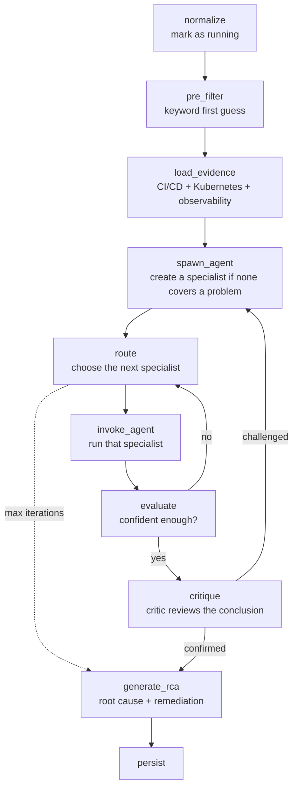
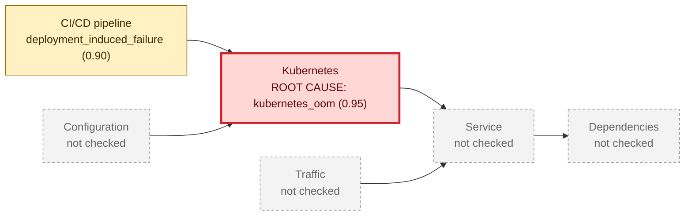

# AgentOps: Adaptive Multi-Agent Intelligence for DevOps

AgentOps investigates a DevOps incident the way an on-call engineer would. It looks at the evidence, asks the specialist most likely to know (CI/CD, Kubernetes, observability, config, dependencies, traffic), checks whether it is confident enough, has a critic challenge the conclusion, and writes a root-cause analysis with a fix.

**What makes it usable by developers:** every investigation leaves a *flow trace*. One command turns it into diagrams that show **which layer of your application is at fault** and **which step of the investigation misbehaved**, if any.

Team: Neil Sulhyan, Huma Naaz Mohammad, Dhriti Shah

---

## Contents

1. [Try it in 2 minutes](#try-it-in-2-minutes)
2. [How an investigation works](#how-an-investigation-works)
3. [How the root cause is decided](#how-the-root-cause-is-decided)
4. [How confidence is computed](#how-confidence-is-computed)
5. [Seeing the prompts and answers](#seeing-the-prompts-and-answers)
6. [Dynamic agent spawning](#dynamic-agent-spawning)
7. [Reading a flow report](#reading-a-flow-report)
8. [The dashboard](#the-dashboard)
9. [Showcase: errors ready to demo](#showcase-errors-ready-to-demo)
10. [Project layout](#project-layout)
11. [Modes: rules, LLM, server](#modes-rules-llm-server)
12. [Configuration](#configuration)
13. [HTTP API](#http-api)
14. [Extending AgentOps](#extending-agentops)
15. [Testing](#testing)
16. [Known limitations](#known-limitations)
17. [Related documents](#related-documents)

---

## Try it in 2 minutes

You need Python 3.11 or newer. No Docker, no MongoDB, no API key.

```bash
python3 -m venv .venv
.venv/bin/pip install -r backend/requirements.txt

# investigate one incident and write reports/shoplite-S2.html
.venv/bin/python scripts/investigate.py run shoplite-S2
```

Output (abridged):

```
shoplite-S2: ShopLite pods OOMKilled repeatedly — memory limit 128Mi exceeded
  Root cause: kubernetes_oom (confidence 0.95, status completed).
  ✔  1. normalize     Start investigation
  ✔  3. load_evidence Load evidence (22 items)
  ✔  4. route         Route #1 -> kubernetes_analyzer
  ✔  5. invoke_agent  kubernetes_analyzer: kubernetes_oom (0.95)
  ✔  7. critique      Critic #1: challenged (0.60)
  ...
  Ground truth: MATCH (expected kubernetes_oom)
  Report: reports/shoplite-S2.html
```

Open `reports/shoplite-S2.html` in a browser for the diagrams.

All commands of the tool:

| Command | What it does |
|---|---|
| `python scripts/investigate.py list` | Scenarios you can run, with their expected root cause |
| `python scripts/investigate.py run <id>` / `run all` | Investigate one scenario or all of them |
| `python scripts/investigate.py run <id> --fault <name>` | Break one part of AgentOps on purpose ([faults](#faults-inside-agentops)) |
| `python scripts/investigate.py run <id> --llm` | Use the real LLM configured in `.env` instead of rules |
| `python scripts/investigate.py faults` | List the injectable faults |
| `python scripts/investigate.py showcase` | Rebuild the ready-made examples in `docs/showcase/` |
| `python scripts/investigate.py report --last` | Report for the latest run in the flow log, including runs made by the server |
| `python scripts/analyze_flow.py` | Step list for every run in `logs/flow.jsonl` |

---

## How an investigation works

An investigation is a [LangGraph](https://langchain-ai.github.io/langgraph/) state machine. Each box below is one function in `backend/orchestrator/graph.py`.



1. **normalize, pre_filter**: marks the run as started and makes a keyword-based first guess (for example the word "OOM" suggests `kubernetes_oom`). The guess only seeds the router; it is never the answer.
2. **load_evidence**: reads the incident's CI/CD, Kubernetes and observability evidence. For scenarios this comes from `data/<layer>/<scenario>.json`; for incidents created by the GitHub monitor the CI/CD evidence arrives attached.
3. **spawn_agent**: if the incident (or later the critic) points at a problem no specialist owns, such as a cache, queue, DNS or a full disk, a new specialist is created for this run. Most runs pass straight through. See [Dynamic agent spawning](#dynamic-agent-spawning).
4. **route**: picks the next specialist. The LLM chooses; if its answer is unusable or names an agent that does not exist, the rule-based router in `backend/orchestrator/router.py` chooses instead.
5. **invoke_agent**: one generic node runs whichever specialist was chosen. Specialists are Markdown prompts in `backend/agents/markdown/`. Each returns a hypothesis, the evidence ids it relied on, and a confidence.
6. **evaluate**: only findings that cite **real** evidence count. Overall confidence comes from the [confidence formula](#how-confidence-is-computed). At or above `CONFIDENCE_THRESHOLD` (0.75) the run moves on; otherwise it routes again, up to `MAX_ITERATIONS`. If at least two specialists looked and every one found nothing wrong, the run also stops: the service looks healthy and no cause is invented.
7. **critique**: the critic reads all findings as one causal chain. If something concrete is missing (for example the conclusion rests on one layer) it sends the run back to the router with a suggested specialist, at most `CRITIC_MAX_ROUNDS` times (default 3). It also challenges when the pre-filter flagged something (for example latency) that no specialist has looked at yet.
8. **generate_rca, persist**: decides the root-cause type (next section), then writes it in plain language plus a remediation plan.

**Every LLM step has a rule-based twin.** If there is no LLM (rules mode) or its answer is not valid JSON for the expected schema, the step uses its rules. In rules mode that is normal and silent. When an LLM answer was unusable the step is flagged amber in the report, so a fallback is never mistaken for a real LLM decision.

---

## How the root cause is decided

Specialists report different links of one causal chain, so the answer is not simply "the most confident finding". Each hypothesis plays one of three roles (`backend/orchestrator/causal.py`):

| Role | Hypotheses | Meaning |
|---|---|---|
| **mechanism** | `kubernetes_oom`, `configuration_error`, `dependency_issue`, `traffic_incident` | a way the system actually breaks |
| **trigger** | `deployment_induced_failure` | the change that set a mechanism off |
| **symptom** | `application_error` | what the mechanism looks like from outside |

Only findings with confidence 0.7 or more count, and the rules run in this order:

1. Two or more **different mechanisms** plus a deployment **trigger** give `multi_layer_failure` (one change broke several layers at once).
2. Otherwise the most confident **mechanism** wins, even over a more confident symptom.
3. With no mechanism, the most confident trigger or symptom wins.
4. If every specialist says "unknown", the answer is `unknown`: the service is healthy and nothing is invented.

The built-in rule-based specialists classify evidence by *kind*, so each can say "nothing wrong here" (and cite what it checked) instead of guessing:

| Specialist | What it tells apart |
|---|---|
| `kubernetes_analyzer` | OOM kills (exit 137, `OOMKilling`) vs a startup crash (exit 1, memory low) vs failing probes vs healthy pods. A pod that merely *started* is not evidence of anything. |
| `cicd_analyzer` | a required setting removed (`configuration_error`) vs a dependency bump (`dependency_issue`) vs a failed deploy, changed code or a resource limit (`deployment_induced_failure`) vs nothing changed. |
| `observability_analyzer` | "unreachable / connection refused" logs (`dependency_issue`) vs "env var not set" (`configuration_error`) vs slow and failing (`traffic_incident`) vs OOM in the logs vs errors only (`application_error`) vs quiet metrics. |

This is what lets the rules-mode engine match the ground truth on all seven ShopLite scenarios.

---

## How confidence is computed

Confidence is calculated by AgentOps from the evidence; an agent's own claim is only one input. The code is `backend/orchestrator/scoring.py`, the numbers are constants at the top of that file, and the Flow tab shows every term for every run.

**1. Finding score**, per specialist, 0 to 1:

```
finding = grounding x ( 0.50 x said + 0.30 x strength + 0.20 x coverage )
```

| Term | Meaning |
|---|---|
| `said` | the specialist's own confidence (rules or LLM) |
| `strength` | average confidence of the real evidence items it cites |
| `coverage` | `min(1, real cited items / 3)`: how much independent evidence backs it |
| `grounding` | real cited items / cited items. Citing evidence that does not exist gives **0**, however sure the agent sounds |

**2. Investigation confidence**, for the root-cause type chosen by [the decision rule](#how-the-root-cause-is-decided):

```
overall = clamp( (base + corroboration - contradiction - open_gaps) x critic , 0, 0.99 )
```

| Term | Value |
|---|---|
| `base` | best finding score among the specialists that support the chosen type |
| `corroboration` | +0.05 for each further layer that supports it (max +0.10) |
| `contradiction` | -0.15 for each strong (0.70 or more) finding that blames a *different* mechanism (max -0.30). The parts of a multi-layer failure do not count against each other |
| `open_gaps` | -0.05 for each question the pre-filter raised that nobody has answered yet (max -0.15) |
| `critic` | x1.0 if confirmed (or not yet run), x0.8 if a challenge is still open |
| cap | 0.99: never certain |

Special case: if every specialist found nothing wrong (`unknown`), `base` is only the highest *reported* value and there is no corroboration. A healthy service is not a confident diagnosis, so it stays at 0.30.

The run stops looking when `overall` reaches `CONFIDENCE_THRESHOLD` (0.75).

**Worked example, ShopLite S6** (`kubernetes_oom` + `deployment_induced_failure` + `traffic_incident`):

| Specialist | said | strength | coverage | grounding | score |
|---|---|---|---|---|---|
| kubernetes | 0.95 | 0.84 | 1.00 | 1.0 | 0.5x0.95 + 0.3x0.84 + 0.2x1.00 = **0.93** |
| cicd | 0.90 | 0.82 | 0.67 | 1.0 | **0.83** |
| observability | 0.85 | 0.85 | 1.00 | 1.0 | **0.88** |

Three layers support `multi_layer_failure`: base 0.93, corroboration +0.10, no contradiction (the three are parts of one failure), no open gaps, critic confirmed: `(0.93 + 0.10) x 1.0` capped at **0.99**.

Because an LLM's self-reported confidence goes through the same formula, a model that says "0.99" while citing evidence that does not exist scores 0, and one that cites real evidence cannot score above what the evidence supports.

---

## Seeing the prompts and answers

In LLM mode every real call is recorded with the **prompt sent**, the **raw answer received**, tokens and time:

- **Always, in the flow log.** It appears as an `llm_call` event and in the Flow tab, inside the step that made the call (an **LLM call** section; a failed call opens by itself). When an answer was unusable and the step went amber, you can read exactly what the model said. Rules mode makes no calls, so there is nothing to show.
- **Optionally, in Langfuse.** Set `LANGFUSE_PUBLIC_KEY` and `LANGFUSE_SECRET_KEY` and each investigation becomes one trace with one generation per call (session id = investigation id), with token and latency views and prompt comparison. Prompts contain your incident logs, so self-host it: `docker compose -f docker-compose.yml -f docker-compose.langfuse.yml up -d`, open http://localhost:3001, create a project, put its keys in `.env`. Langfuse is not required and failures in it never affect an investigation.

Langfuse shows the LLM calls; the flow report shows what the investigation made of them (grounded evidence, fallbacks, the layer at fault). They complement each other.

---

## Dynamic agent spawning

The `.md` specialists cannot cover everything. When an incident, or the critic, points at something none of them owns, the `spawn_agent` node creates a specialist **while the investigation runs** (`backend/runtime/spawner.py`).

```
"Redis maxmemory reached, evicting keys"
        |
        v   pre_filter: the text matches the "cache" focus -> evidence gap "cache_health"
   spawn_agent  -->  creates cache_analyzer (prompt rendered from agents/markdown/_template.md,
        |             keyword rules from the focus catalog), registered for THIS investigation
        v
      route  -->  runs it first ("spawned for this incident")  -->  evaluate  -->  critique ...
```

- **What it can spawn:** `FOCUS_CATALOG` in `spawner.py` lists the problems it knows: cache, queue, network and DNS, storage, certificates, rate limiting. To teach it another, add one entry (keywords, evidence types, what it concludes).
- **It is a normal specialist afterwards.** In LLM mode it uses the rendered prompt; in rules mode its keyword rules (capped at 0.8 confidence, versus 0.65 for the generic keyword agents).
- **It is visible.** The flow report has a `spawn_agent` step saying what nobody covered and why, and the agent is badged "spawned" in the dashboard.
- **Try it:** `python scripts/investigate.py run incident-008` (a Redis cache filling up and evicting keys).
- **Keep one you like:** `POST /api/agents` (or the Agents page) writes a real `.md` with front-matter; every later investigation can use it. See [Extending AgentOps](#extending-agentops).

---

## Reading a flow report

Every step writes one JSON line to `logs/flow.jsonl` (`backend/flow/log.py`). `backend/flow/trace.py` folds the lines of one investigation into ordered steps, each **ok**, **warning** or **error**. Everything below is drawn from that single structure.

| Colour | Meaning |
|---|---|
| green | fine |
| amber | worth a look: a fallback was used, a finding was ignored, the critic's doubt stayed unresolved |
| red | the fault: a step raised an exception, or (in the app map) the layer holding the root cause |
| grey dashed | not visited / not checked |

A report has four parts:

1. **Verdict**: one sentence, for example `Investigation FAILED at node 'invoke_agent'.`
2. **Steps that need attention**: only the amber and red steps, with the reason in plain language.
3. **Where the fault is in the application** (the *app map*): six layers of the investigated system, with the root-cause layer in red and layers with real findings in amber. Example, ShopLite pods being OOM-killed:



4. **How the investigation ran** (the *pipeline map*): the graph above, each node coloured by what happened there, with the path actually taken drawn thick. Then a step-by-step table with timings.

Reports come as `.html` (open in a browser; diagrams need internet for the Mermaid CDN) and `.md` (renders on GitHub and in VS Code).

---

## The dashboard

The React dashboard (`frontend/`, see [Run the full stack](#run-the-full-stack)) has a **Flow** tab on every investigation. It is the same information as the HTML report, interactive:

1. **A verdict banner** says how the run ended and lists every step that needs attention; click one to jump to it.
2. **The pipeline diagram** shows the graph top to bottom. Green is fine, amber is worth a look, red failed, dashed grey was never reached. The thick blue line is the path actually taken; a number badge means the node ran several times.
3. **Click any box to look inside it.** The panel on the right opens that step as boxes from inputs to decision to output. For `route` that is the gaps, the candidates, whether the LLM or the rules decided, and the chosen agent. For `invoke_agent` it is the finding, how many pieces of evidence it cited, how many actually exist, and whether it counts toward confidence. The evidence it cites is listed and opens in the evidence viewer; an invented evidence id is shown in red. Nodes visited more than once have a tab per visit. The raw flow events are one click away.
4. **The app map** shows the six layers of the investigated service with the root-cause layer in red.
5. **What each specialist found** lists hypothesis and confidence, and marks spawned agents.

**Apps and history.** The **Apps** page has one card per application (ShopLite, and one for each other service in `data/incidents`). An app page has two tabs:

- **Incidents**: every incident of the app with its latest result, a `matches ground truth` badge where a ground truth exists, and an **Investigate** / **Re-investigate** button.
- **History**: every run of every incident, newest first, filterable by incident.

Re-investigating never overwrites anything: each run is a new investigation and the old ones stay. Every investigation page also has a **Re-investigate** button and its own **History** tab listing the runs of that incident. App membership comes from the scenario catalogue (`shoplite-*` ids belong to ShopLite, others to their `service_name`); names and descriptions are set in `data/apps.json`.

**Where the flow comes from.** While a run is going, its events are in the flow log (`logs/flow.jsonl`; Docker mounts `./logs` so host and container share it). When the run finishes they are also saved in MongoDB (`flow_events`), so the Flow tab works for runs made by any process and survives the log file being lost. Runs from before this existed have no flow data.

The **Agents** page lists every specialist, the kinds of agent the spawner can create, and a form that adds a new specialist without touching code. The tab updates while an investigation is running.

---

## Showcase: errors ready to demo

[`docs/showcase/`](docs/showcase/README.md) contains 14 pre-built reports. Rebuild them with `python scripts/investigate.py showcase`. There are two kinds of error.

### Faults in the application (ShopLite)

[ShopLite](../ShopLite) is a small, deliberately breakable FastAPI service with a real CI pipeline and known root causes. Its seven failure scenarios are replayed here as `shoplite-S1` to `shoplite-S7`. The report shows which layer of ShopLite is broken.

| Scenario | What broke in ShopLite | Expected root cause |
|---|---|---|
| `shoplite-S1` | Tests broken after a commit | `deployment_induced_failure` |
| `shoplite-S2` | Pod OOM-killed (128Mi limit) | `kubernetes_oom` |
| `shoplite-S3` | Latency and 5xx spike | `traffic_incident` |
| `shoplite-S4` | Missing env var, CrashLoopBackOff | `configuration_error` |
| `shoplite-S5` | Database unreachable | `dependency_issue` |
| `shoplite-S6` | OOM + latency + errors together | `multi_layer_failure` |
| `shoplite-S7` | Healthy control | `unknown` (no invented cause) |

In **rules mode** all seven match their ground truth (a test, `tests/test_rules.py`, keeps it that way). The report ends with a `MATCH` or `MISMATCH` line against `data/ground_truth/`, which is also how you spot a regression after changing a rule.

### Dynamic agent spawning

`incident-008` (a full Redis cache) is the scenario that needs a specialist nobody wrote. Its report has a `spawn_agent` step and a `cache_analyzer` marked as spawned.

### Faults inside AgentOps

`--fault <name>` breaks one part of AgentOps on purpose, on the same incident (`shoplite-S2`), so you can see how each failure shows up.

| Fault | What is broken | What the report shows |
|---|---|---|
| `llm_bad_json` | Every LLM answer is prose, not JSON | amber on `route`, `invoke_agent`, `critique`, `generate_rca`; the run still finishes via rules |
| `router_unknown_agent` | Router picks an agent that does not exist | amber on `route`; the rule-based router chose instead |
| `ungrounded_finding` | Specialists cite evidence ids that do not exist | amber on `invoke_agent`; confidence stays 0, root cause `unknown` |
| `critic_always_challenges` | The critic rejects everything | amber on the last `critique`: rounds ran out, doubt unresolved, confidence 0.30 |
| `agent_crash` | The specialist's LLM call raises | **red** on `invoke_agent`; status `failed` |
| `missing_evidence` | No evidence can be loaded | amber on `load_evidence`; nothing can be grounded, root cause `unknown` |

```bash
python scripts/investigate.py run shoplite-S2 --fault agent_crash
```

```
  Investigation FAILED at node 'invoke_agent'.
  ✔  4. route         Route #1 -> kubernetes_analyzer
  ✖  5. invoke_agent  invoke_agent (kubernetes_analyzer) FAILED
         RuntimeError: LLM provider timed out after 60s (injected fault: agent_crash)
```

Faults replace the LLM and are defined in `backend/faults.py`, one entry per fault.

---

## Project layout

```
backend/
  main.py                    FastAPI app
  config.py                  all settings, with defaults that work on a fresh clone
  faults.py                  injectable faults (demo / testing)
  orchestrator/
    graph.py                 THE investigation: nodes and wiring        <- start reading here
    run.py                   run_investigation(): run the graph in-process
    router.py                rule-based router (fallback for the LLM router)
    critic.py                rule-based critic (fallback for the LLM critic)
    causal.py                decides the root-cause type: mechanism > trigger > symptom
    scoring.py               the confidence formula (finding score, investigation confidence)
    confidence.py            overall confidence, rule-based RCA and remediation
    state.py                 persists investigations to MongoDB
  runtime/
    agent_loader.py          finds agents: every .md file in agents/markdown/
    agent_spec.py            an agent's front-matter: layer, hypothesis, keywords (rules without Python)
    spawner.py               creates specialists at run time (FOCUS_CATALOG)
    agent_runner.py          runs one agent step: prompt -> LLM -> validate, else rules
  agents/
    markdown/*.md            the agents' prompts (router, critic, specialists, rca, remediation); _template.md is for spawned agents
    {cicd,kubernetes,observability}/agent.py   rule-based specialists   signals.py  helpers they share
  llm/
    base.py                  provider interface         rules.py   no-LLM mode
    nemotron.py              NVIDIA Nemotron client     schemas.py expected JSON shapes
  flow/                      flow log -> trace -> diagrams -> reports
    log.py  trace.py  layers.py  diagram.py  report.py  export.py (JSON for the dashboard)
  services/                  investigation_service (API), github_monitor, scenarios
  data_sources/github_actions/   GitHub Actions client + adapter
  tools/data_access.py       reads evidence fixtures from data/
  api/                       REST routes + WebSocket
data/                        replayable scenarios: incidents, cicd, kubernetes, observability, ground_truth
scripts/                     investigate.py (main tool), clear_investigations.py (empty the database; dry run unless --yes), analyze_flow.py, trigger_incident.py, generate_scenarios.py
frontend/                    React dashboard (src/components/flow = the Flow tab, src/pages/Agents.tsx)
evaluation/                  baseline-vs-adaptive experiments
docs/                        SETUP.md, CRITIC_REPORT.md, showcase/
tests/
```

The dependency direction is one-way: `flow` knows nothing about the orchestrator; the orchestrator writes events to `flow.log`; `scripts/investigate.py` reads them back.

---

## Modes: rules, LLM, server

| Mode | How | Needs | Use for |
|---|---|---|---|
| **Rules** (default) | nothing to set, or `LLM_PROVIDER=rules` | nothing | demos, tests, CI, understanding the flow |
| **LLM** | `LLM_PROVIDER=nemotron` plus `NEMOTRON_API_KEY`, `NEMOTRON_API_URL` | network, API key | real investigations |
| **Server** | `docker compose up` or `uvicorn backend.main:app` | MongoDB | the dashboard, GitHub monitoring, the HTTP API |

The CLI always uses rules unless you pass `--llm`. The server uses whatever `LLM_PROVIDER` says. Server runs write to the same flow log, so `investigate.py report <investigation_id>` works for them too.

To save every LLM prompt and response: `LLM_TRACE_ENABLED=true` writes `logs/llm_traces.jsonl`. Those files contain incident data; keep them local.

### Run the full stack

```bash
cp .env.example .env          # then fill in MONGODB_URI and, for the LLM, NEMOTRON_*
docker compose up -d
# Frontend http://localhost:3000   API http://localhost:8000   Docs http://localhost:8000/docs
```

Replay a scenario against the running server:

```bash
python scripts/trigger_incident.py list
python scripts/trigger_incident.py run shoplite-S2 --wait
```

---

## Configuration

Set as environment variables or in `.env`. Defaults work on a fresh clone with no `.env`.

| Variable | Default | Meaning |
|---|---|---|
| `LLM_PROVIDER` | `rules` | `rules` or `nemotron` |
| `NEMOTRON_API_KEY`, `NEMOTRON_API_URL`, `NEMOTRON_MODEL` | none | LLM access |
| `CONFIDENCE_THRESHOLD` | `0.75` | confidence at which an investigation stops asking specialists |
| `MAX_ITERATIONS` | `5` | maximum specialist runs per investigation |
| `LANGFUSE_PUBLIC_KEY` / `LANGFUSE_SECRET_KEY` / `LANGFUSE_HOST` | empty | optional: send every LLM call to Langfuse |
| `ENABLE_CRITIC` / `CRITIC_MAX_ROUNDS` | `true` / `3` | the critic and how often it may send a run back |
| `FAULT_INJECTION` | empty | one of the fault names above |
| `FLOW_LOG_ENABLED` / `FLOW_LOG_PATH` | `true` / `<repo>/logs/flow.jsonl` | the flow log |
| `DATA_DIR` | `<repo>/data` | scenario fixtures. If the path does not exist a warning is printed and `<repo>/data` is used |
| `MONGODB_URI`, `MONGODB_DATABASE` | `mongodb://localhost:27017`, `agentops` | server mode only |
| `GITHUB_TOKEN`, `GITHUB_OWNER`, `GITHUB_REPO`, `GITHUB_BRANCH` | none | GitHub Actions monitor only |

Never commit `.env`. It is gitignored.

---

## HTTP API

Interactive docs at `/docs`. The main routes:

| Route | Purpose |
|---|---|
| `GET /api/scenarios`, `POST /api/scenarios/{id}/trigger`, `POST /api/scenarios/trigger-all` | replay scenarios |
| `POST /api/incidents` | investigate a new incident (needs GitHub settings for CI/CD evidence) |
| `GET /api/incidents`, `GET /api/incidents/{id}` | list investigations |
| `GET /api/investigations/{id}` | full state |
| `GET /api/investigations/{id}/timeline` / `evidence` / `critic` / `root-cause` / `remediation` | parts of the result |
| `GET /api/investigations/{id}/flow` | the flow trace as JSON: steps, pipeline nodes and edges with status, app layers, spawned agents (what the Flow tab draws) |
| `GET /api/apps`, `GET /api/apps/{key}` | apps, their incidents and runs (with ground-truth match) |
| `GET /api/incidents/{incident_id}/runs` | every run of one incident |
| `POST /api/investigations/{id}/rerun` | investigate the same incident again; the previous run is kept |
| `GET /api/agents` | every specialist, plus the kinds the spawner can create |
| `POST /api/agents` | add a specialist: `{name, description, layer, hypothesis, evidence_types, keywords}` writes a `.md` file |
| `WS /api/investigations/{id}/ws` | live progress |

---

## Extending AgentOps

**Add a specialist.** Drop `my_agent.md` into `backend/agents/markdown/` (copy an existing one; keep the *Output Format* section), or use the Agents page / `POST /api/agents`. It is discovered automatically and offered to the router. Put this front-matter at the top to give it a rule-based twin and a place on the app map, with no Python:

```yaml
---
description: Cache health (Redis, Memcached)
layer: dependency            # cicd | config | kubernetes | service | traffic | dependency
hypothesis: dependency_issue # what it concludes when evidence matches
evidence_types: [log, error_rate]
keywords: [redis, eviction]
---
```

Without front-matter it works in LLM mode only; in rules mode it reports "found nothing".

**Teach the spawner a new problem.** Add one `Focus(...)` entry to `FOCUS_CATALOG` in `backend/runtime/spawner.py`.

**Add a fault.** Add an entry to `FAULTS` and a branch in `FaultInjectingLLM.generate` in `backend/faults.py`. `tests/test_flow.py` automatically checks that every fault leaves a visible mark in the report.

**Add a scenario.** Add `data/incidents/<id>.json`, matching files in `data/cicd`, `data/kubernetes`, `data/observability`, and `data/ground_truth/<id>.json`. It appears in `investigate.py list` immediately.

**Change the graph.** Edit `build_investigation_graph()` in `backend/orchestrator/graph.py`, then update `PIPELINE_NODES` / `PIPELINE_EDGES` in `backend/flow/diagram.py`. A test fails until the two match, so the diagram cannot silently go stale.

---

## Testing

```bash
.venv/bin/python -m pytest
```

Tests run fully offline in rules mode and write their flow log to a temporary file (`tests/conftest.py`). One test needs a real database and is skipped unless you opt in:

```bash
AGENTOPS_TEST_MONGO=1 MONGODB_URI=mongodb://localhost:27017 .venv/bin/python -m pytest tests/test_orchestrator.py
```

Point it at a throwaway database: it creates and deletes records.

`tests/test_rules.py` pins the rule-based engine to the ground truth of all seven ShopLite scenarios and covers the root-cause decision, negation handling, the spawner and the flow/agents API. `tests/test_flow.py` covers the flow tooling: trace building, colouring rules, that the diagram matches the real graph, and that every injectable fault is visible in the report.

---

## Known limitations

- **Rule-based specialists are keyword rules, not a diagnosis engine.** They match all seven ShopLite scenarios and `incident-008`, and 13 of the 15 scenarios overall. The misses are `incident-001` and `incident-004`, where the data labels a deployment as the cause while the rules, by design, name the mechanism the deployment triggered (an OOM, a missing setting). Anything outside the patterns in `backend/agents/*/agent.py` needs the LLM.
- **The confidence weights are reasoned, not fitted.** The numbers in [How confidence is computed](#how-confidence-is-computed) are sensible defaults, not calibrated against real incident outcomes; tune them with the evaluation runs once you have them.
- **Evidence given to the LLM is truncated to the last 40 items**, and CI/CD evidence is loaded first, so on big incidents it can be cut. Open issue, see the critic report.
- Several smaller open items (for example `InvestigationStatus.INSUFFICIENT_EVIDENCE` is never set, `current_hypothesis` is not updated after the first guess) are listed with their status in the critic report.

---

## Related documents

| Document | What it is |
|---|---|
| [`docs/SETUP.md`](docs/SETUP.md) | every tool and version needed to reproduce this, for citing in the project report |
| [`docs/CRITIC_REPORT.md`](docs/CRITIC_REPORT.md) | the independent code review: findings, evidence, and what has been fixed |
| [`docs/showcase/README.md`](docs/showcase/README.md) | the 13 ready-made flow reports |
| [`decisions.md`](decisions.md) | log of past decisions and fixes |
| [`../ShopLite`](../ShopLite/README.md) | the breakable target application |
