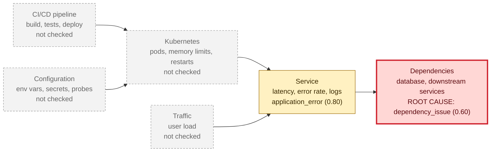
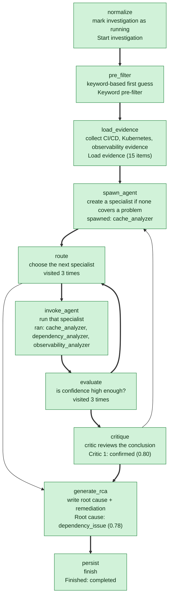

# Flow report: incident-008

**Checkout latency and errors: Redis cache full and evicting keys**

- Result: Root cause: dependency_issue (confidence 0.78, status completed).
- Decisions made by: `rules`
- Investigation id: `b9a59892-ece5-4bb2-8ee8-0d7b52f5d08b`

## Steps that need attention

None. Every step of the investigation ran cleanly.

## Where the fault is in the application

_green = fine · amber = worth a look · red = the fault · grey dashed = not visited_

## How the investigation ran

_Thick arrows are the path that was taken._

## Step by step

| # | | Node | What happened | Details |
|---|---|---|---|---|
| 1 | ✔ | `normalize` | Start investigation | Incident incident-008: Checkout latency and errors: Redis cache full and evicting keys Decisions made by: rules |
| 2 | ✔ | `pre_filter` | Keyword pre-filter | First guess: traffic_incident Wants to know about: observability_metrics, cache_health |
| 3 | ✔ | `load_evidence` | Load evidence (15 items) | Sources: kubernetes_fixture, observability_fixture |
| 4 | ✔ | `spawn_agent` | Spawned cache_analyzer | No available specialist covers this, so cache_analyzer was created: Cache: cache servers that are full, evicting keys, or no longer absorbing load Because: The incident mentions cache and no specialist covers it: "Checkout latency and errors: Redis cache full and evicting keys" |
| 5 | ✔ | `route` | Route #1 -> cache_analyzer | Spawned for this incident (Cache: cache servers that are full, evicting keys, or no longer absorbing load); nothing else covers it, so it runs first |
| 6 | ✔ | `invoke_agent` | cache_analyzer: dependency_issue (0.75) | Cache: Log: Redis maxmemory reached: evicting keys (allkeys-lru), used_memory 2.00GB of 2.00GB; Log: Redis evicted_keys=1.2M in the last 10 minutes; cache hit ratio 18%; Log: GET /cart 500: cache lookup failed, falling back to database Evidence cited: 3, of which real: 3 |
| 7 | ✔ | `evaluate` | Confidence 0.68 / 0.75 (not enough yet) | Per agent: cache_analyzer 0.78 |
| 8 | ✔ | `route` | Route #2 -> dependency_analyzer | Recent finding suggests dependency_issue; routing to dependency_analyzer |
| 9 | ✔ | `invoke_agent` | dependency_analyzer: dependency_issue (0.60) | Failing dependencies - databases, caches, downstream services, libraries: Log: GET /cart 500: cache lookup failed, falling back to database; Log: cache miss ratio 82% for key prefix session:*, every request now reads the database Evidence cited: 2, of which real: 2 |
| 10 | ✔ | `evaluate` | Confidence 0.73 / 0.75 (not enough yet) | Per agent: cache_analyzer 0.78, dependency_analyzer 0.64 |
| 11 | ✔ | `route` | Route #3 -> observability_analyzer | Hypothesis 'traffic_incident' maps to observability_analyzer |
| 12 | ✔ | `invoke_agent` | observability_analyzer: application_error (0.80) | The application is erroring (14% errors, 0 stack traces) Evidence cited: 1, of which real: 1 |
| 13 | ✔ | `evaluate` | Confidence 0.78 / 0.75 (enough) | Per agent: cache_analyzer 0.78, dependency_analyzer 0.64, observability_analyzer 0.74 |
| 14 | ✔ | `critique` | Critic #1: confirmed (0.80) |  |
| 15 | ✔ | `generate_rca` | Root cause: dependency_issue (0.78) | Agents used: cache_analyzer -> dependency_analyzer -> observability_analyzer |
| 16 | ✔ | `persist` | Finished: completed |  |
