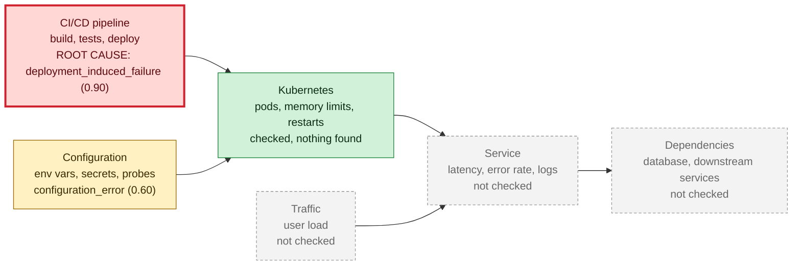
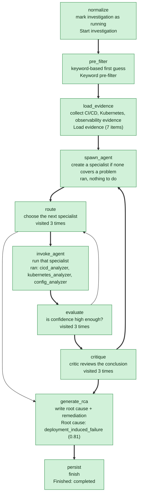

# Flow report: shoplite-S1

**ShopLite CI pipeline failing — tests broken after commit**

- Result: Root cause: deployment_induced_failure (confidence 0.81, status completed).
- Decisions made by: `rules`
- Investigation id: `fbdbace3-3e93-4166-9227-ce940ef8b2e6`

## Steps that need attention

None. Every step of the investigation ran cleanly.

## Where the fault is in the application

_green = fine · amber = worth a look · red = the fault · grey dashed = not visited_

## How the investigation ran

_Thick arrows are the path that was taken._

## Step by step

| # | | Node | What happened | Details |
|---|---|---|---|---|
| 1 | ✔ | `normalize` | Start investigation | Incident shoplite-S1: ShopLite CI pipeline failing — tests broken after commit Decisions made by: rules |
| 2 | ✔ | `pre_filter` | Keyword pre-filter | First guess: unknown |
| 3 | ✔ | `load_evidence` | Load evidence (7 items) | Sources: cicd_fixture, observability_fixture |
| 4 | ✔ | `route` | Route #1 -> cicd_analyzer | Default selection: cicd_analyzer |
| 5 | ✔ | `invoke_agent` | cicd_analyzer: deployment_induced_failure (0.90) | The deployment failed; the incident starts right after it: Deployment shoplite-deploy-S1 at 2024-06-01T09:00:00Z Evidence cited: 3, of which real: 2 |
| 6 | ✔ | `evaluate` | Confidence 0.81 / 0.75 (enough) | Per agent: cicd_analyzer 0.81 |
| 7 | ✔ | `critique` | Critic #1: challenged (0.60) | The 'deployment_induced_failure' conclusion rests on a single layer (cicd_analyzer); nothing independent corroborates it. Sent back to the router; suggested agent: kubernetes_analyzer |
| 8 | ✔ | `route` | Route #2 -> kubernetes_analyzer | Critic challenged the conclusion and suggested kubernetes_analyzer |
| 9 | ✔ | `invoke_agent` | kubernetes_analyzer: unknown (0.10) | No Kubernetes evidence found for this incident Evidence cited: 0, of which real: 0 |
| 10 | ✔ | `evaluate` | Confidence 0.81 / 0.75 (enough) | Per agent: cicd_analyzer 0.81 |
| 11 | ✔ | `critique` | Critic #2: challenged (0.60) | The 'deployment_induced_failure' conclusion rests on a single layer (cicd_analyzer); nothing independent corroborates it. Sent back to the router; suggested agent: config_analyzer |
| 12 | ✔ | `route` | Route #3 -> config_analyzer | Critic challenged the conclusion and suggested config_analyzer |
| 13 | ✔ | `invoke_agent` | config_analyzer: configuration_error (0.60) | Configuration changes - env vars, secrets, probes, ports: Config change: FLAKY_TESTS = true; Log: FAILED tests/test_app.py::test_flaky_import_error - ModuleNotFoundError: No module named 'app.nonexistent_module' Evidence cited: 2, of which real: 2 |
| 14 | ✔ | `evaluate` | Confidence 0.81 / 0.75 (enough) | Per agent: cicd_analyzer 0.81, config_analyzer 0.67 |
| 15 | ✔ | `critique` | Critic #3: confirmed (0.90) |  |
| 16 | ✔ | `generate_rca` | Root cause: deployment_induced_failure (0.81) | Agents used: cicd_analyzer -> kubernetes_analyzer -> config_analyzer |
| 17 | ✔ | `persist` | Finished: completed |  |
