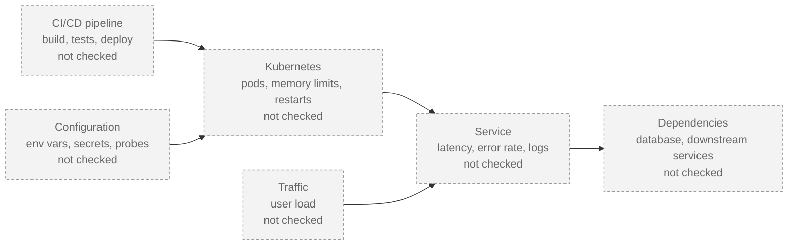
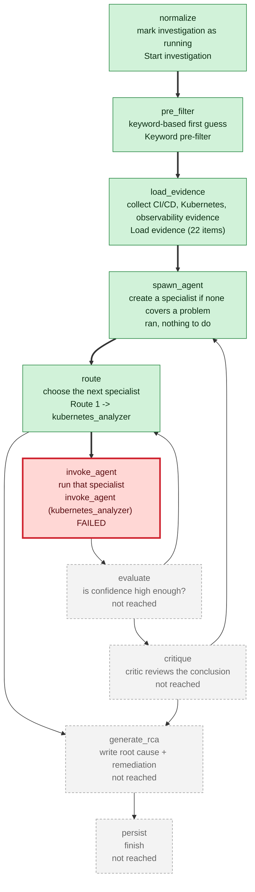

# Flow report: shoplite-S2

**ShopLite pods OOMKilled repeatedly — memory limit 128Mi exceeded**

- Result: Investigation FAILED at node 'invoke_agent'.
- Decisions made by: `rules+fault:agent_crash`
- Investigation id: `27340da4-303a-48d8-a5f7-59577c79bb8c`
- Injected fault (demo): `agent_crash`

## Steps that need attention

- ✖ **invoke_agent** - invoke_agent (kubernetes_analyzer) FAILED
  - RuntimeError: LLM provider timed out after 60s (injected fault: agent_crash)

## Where the fault is in the application

_green = fine · amber = worth a look · red = the fault · grey dashed = not visited_

## How the investigation ran

_Thick arrows are the path that was taken._

## Step by step

| # | | Node | What happened | Details |
|---|---|---|---|---|
| 1 | ✔ | `normalize` | Start investigation | Incident shoplite-S2: ShopLite pods OOMKilled repeatedly — memory limit 128Mi exceeded Decisions made by: rules+fault:agent_crash Injected fault for this demo run: agent_crash |
| 2 | ✔ | `pre_filter` | Keyword pre-filter | First guess: kubernetes_oom Wants to know about: deployment_details, pod_memory_status, pod_restart_pattern |
| 3 | ✔ | `load_evidence` | Load evidence (22 items) | Sources: cicd_fixture, kubernetes_fixture, observability_fixture |
| 4 | ✔ | `route` | Route #1 -> kubernetes_analyzer | Hypothesis 'kubernetes_oom' maps to kubernetes_analyzer |
| 5 | ✖ | `invoke_agent` | invoke_agent (kubernetes_analyzer) FAILED | RuntimeError: LLM provider timed out after 60s (injected fault: agent_crash) |
