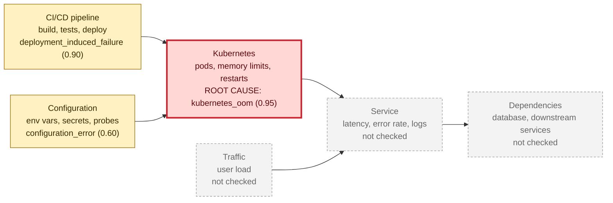
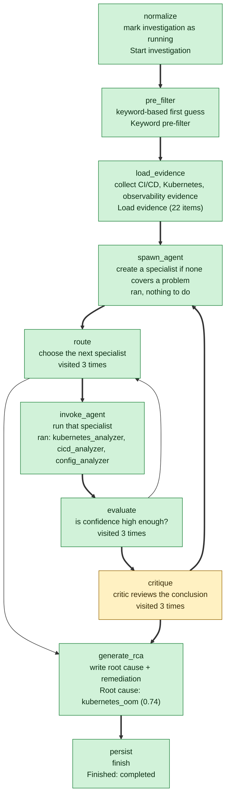

# Flow report: shoplite-S2

**ShopLite pods OOMKilled repeatedly — memory limit 128Mi exceeded**

- Result: Root cause: kubernetes_oom (confidence 0.74, status completed).
- Decisions made by: `rules+fault:critic_always_challenges`
- Investigation id: `e7a188c5-9c0c-47b0-a6fb-c97ab88062e5`
- Injected fault (demo): `critic_always_challenges`

## Steps that need attention

- ⚠ **critique** - Critic #3: challenged (0.30)
  - The conclusion is not convincing (injected fault: the critic rejects everything).
  - Could not loop back (no rounds, iterations or unused agents left); the root cause is reported with this concern unresolved.

## Where the fault is in the application

_green = fine · amber = worth a look · red = the fault · grey dashed = not visited_

## How the investigation ran

_Thick arrows are the path that was taken._

## Step by step

| # | | Node | What happened | Details |
|---|---|---|---|---|
| 1 | ✔ | `normalize` | Start investigation | Incident shoplite-S2: ShopLite pods OOMKilled repeatedly — memory limit 128Mi exceeded Decisions made by: rules+fault:critic_always_challenges Injected fault for this demo run: critic_always_challenges |
| 2 | ✔ | `pre_filter` | Keyword pre-filter | First guess: kubernetes_oom Wants to know about: deployment_details, pod_memory_status, pod_restart_pattern |
| 3 | ✔ | `load_evidence` | Load evidence (22 items) | Sources: cicd_fixture, kubernetes_fixture, observability_fixture |
| 4 | ✔ | `route` | Route #1 -> kubernetes_analyzer | Hypothesis 'kubernetes_oom' maps to kubernetes_analyzer |
| 5 | ✔ | `invoke_agent` | kubernetes_analyzer: kubernetes_oom (0.95) | 2 pod(s) were OOMKilled (exit code 137): they used more memory than their limit allows Evidence cited: 6, of which real: 6 |
| 6 | ✔ | `evaluate` | Confidence 0.88 / 0.75 (enough) | Per agent: kubernetes_analyzer 0.93 |
| 7 | ✔ | `critique` | Critic #1: challenged (0.30) | The conclusion is not convincing (injected fault: the critic rejects everything). Sent back to the router; suggested agent: None |
| 8 | ✔ | `route` | Route #2 -> cicd_analyzer | Evidence gap 'deployment_details' maps to cicd_analyzer |
| 9 | ✔ | `invoke_agent` | cicd_analyzer: deployment_induced_failure (0.90) | A resource limit was changed in the release; the incident starts right after it: Config change: resources.limits.memory = 128Mi Evidence cited: 2, of which real: 2 |
| 10 | ✔ | `evaluate` | Confidence 0.93 / 0.75 (enough) | Per agent: kubernetes_analyzer 0.93, cicd_analyzer 0.83 |
| 11 | ✔ | `critique` | Critic #2: challenged (0.30) | The conclusion is not convincing (injected fault: the critic rejects everything). Sent back to the router; suggested agent: None |
| 12 | ✔ | `route` | Route #3 -> config_analyzer | Default selection: config_analyzer |
| 13 | ✔ | `invoke_agent` | config_analyzer: configuration_error (0.60) | Configuration changes - env vars, secrets, probes, ports: Config change: FAULT = oom; Config change: resources.limits.memory = 128Mi Evidence cited: 2, of which real: 2 |
| 14 | ✔ | `evaluate` | Confidence 0.93 / 0.75 (enough) | Per agent: kubernetes_analyzer 0.93, cicd_analyzer 0.83, config_analyzer 0.69 |
| 15 | ⚠ | `critique` | Critic #3: challenged (0.30) | The conclusion is not convincing (injected fault: the critic rejects everything). Could not loop back (no rounds, iterations or unused agents left); the root cause is reported with this concern unresolved. |
| 16 | ✔ | `generate_rca` | Root cause: kubernetes_oom (0.74) | Agents used: kubernetes_analyzer -> cicd_analyzer -> config_analyzer |
| 17 | ✔ | `persist` | Finished: completed |  |
