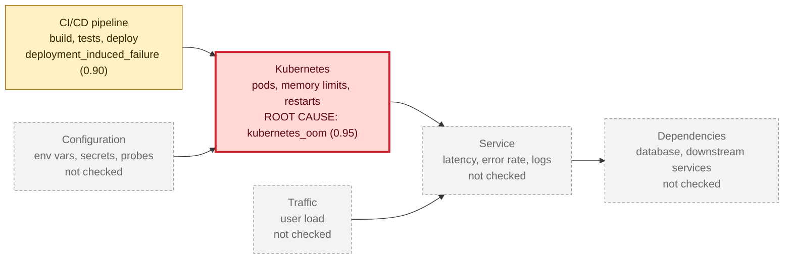
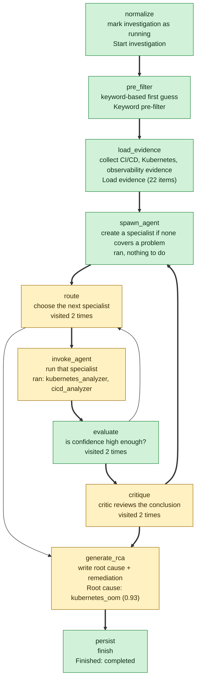

# Flow report: shoplite-S2

**ShopLite pods OOMKilled repeatedly — memory limit 128Mi exceeded**

- Result: Root cause: kubernetes_oom (confidence 0.93, status completed).
- Decisions made by: `rules+fault:llm_bad_json`
- Investigation id: `07cd1616-e711-4fc5-ac6d-4ad38aea9b65`
- Injected fault (demo): `llm_bad_json`

## Steps that need attention

- ⚠ **route** - Route #1 -> kubernetes_analyzer
  - LLM answer for routing was unusable; rules took over. 1 validation error for RoutingDecisionResponse Invalid JSON: expected value at line 1 column 1 [type=json_invalid, input_value='Sure! Looking at the evi...k th…
  - Hypothesis 'kubernetes_oom' maps to kubernetes_analyzer
- ⚠ **invoke_agent** - kubernetes_analyzer: kubernetes_oom (0.95)
  - LLM answer for analysis (kubernetes_analyzer) was unusable; rules took over. 1 validation error for AgentAnalysisResponse Invalid JSON: expected value at line 1 column 1 [type=json_invalid, input_value='Sure! Looking at the evi...k the …
  - 2 pod(s) were OOMKilled (exit code 137): they used more memory than their limit allows
  - Evidence cited: 6, of which real: 6
- ⚠ **critique** - Critic #1: challenged (0.60)
  - LLM answer for critic was unusable; rules took over. 1 validation error for CriticResponse Invalid JSON: expected value at line 1 column 1 [type=json_invalid, input_value='Sure! Looking at the evi...k the pod is …
  - The 'kubernetes_oom' conclusion rests on a single layer (kubernetes_analyzer); nothing independent corroborates it.
  - The pre-filter flagged 'deployment_details' but cicd_analyzer has not looked at it yet.
  - Sent back to the router; suggested agent: cicd_analyzer
- ⚠ **route** - Route #2 -> cicd_analyzer
  - LLM answer for routing was unusable; rules took over. 1 validation error for RoutingDecisionResponse Invalid JSON: expected value at line 1 column 1 [type=json_invalid, input_value='Sure! Looking at the evi...k th…
  - Critic challenged the conclusion and suggested cicd_analyzer
- ⚠ **invoke_agent** - cicd_analyzer: deployment_induced_failure (0.90)
  - LLM answer for analysis (cicd_analyzer) was unusable; rules took over. 1 validation error for AgentAnalysisResponse Invalid JSON: expected value at line 1 column 1 [type=json_invalid, input_value='Sure! Looking at the evi...k the …
  - A resource limit was changed in the release; the incident starts right after it: Config change: resources.limits.memory = 128Mi
  - Evidence cited: 2, of which real: 2
- ⚠ **critique** - Critic #2: confirmed (0.95)
  - LLM answer for critic was unusable; rules took over. 1 validation error for CriticResponse Invalid JSON: expected value at line 1 column 1 [type=json_invalid, input_value='Sure! Looking at the evi...k the pod is …
- ⚠ **generate_rca** - Root cause: kubernetes_oom (0.93)
  - LLM answer for rca was unusable; rules took over. 1 validation error for RCAResponse Invalid JSON: expected value at line 1 column 1 [type=json_invalid, input_value='Sure! Looking at the evi...k the pod is unh…
  - LLM answer for remediation was unusable; rules took over. 1 validation error for RemediationResponse Invalid JSON: expected value at line 1 column 1 [type=json_invalid, input_value='Sure! Looking at the evi...k the po…
  - Agents used: kubernetes_analyzer -> cicd_analyzer

## Where the fault is in the application

_green = fine · amber = worth a look · red = the fault · grey dashed = not visited_

## How the investigation ran

_Thick arrows are the path that was taken._

## Step by step

| # | | Node | What happened | Details |
|---|---|---|---|---|
| 1 | ✔ | `normalize` | Start investigation | Incident shoplite-S2: ShopLite pods OOMKilled repeatedly — memory limit 128Mi exceeded Decisions made by: rules+fault:llm_bad_json Injected fault for this demo run: llm_bad_json |
| 2 | ✔ | `pre_filter` | Keyword pre-filter | First guess: kubernetes_oom Wants to know about: deployment_details, pod_memory_status, pod_restart_pattern |
| 3 | ✔ | `load_evidence` | Load evidence (22 items) | Sources: cicd_fixture, kubernetes_fixture, observability_fixture |
| 4 | ⚠ | `route` | Route #1 -> kubernetes_analyzer | LLM answer for routing was unusable; rules took over. 1 validation error for RoutingDecisionResponse Invalid JSON: expected value at line 1 column 1 [type=json_invalid, input_value='Sure! Looking at the evi...k th… Hypothesis 'kubernetes_oom' maps to kubernetes_analyzer |
| 5 | ⚠ | `invoke_agent` | kubernetes_analyzer: kubernetes_oom (0.95) | LLM answer for analysis (kubernetes_analyzer) was unusable; rules took over. 1 validation error for AgentAnalysisResponse Invalid JSON: expected value at line 1 column 1 [type=json_invalid, input_value='Sure! Looking at the evi...k the … 2 pod(s) were OOMKilled (exit code 137): they used more memory than their limit allows Evidence cited: 6, of which real: 6 |
| 6 | ✔ | `evaluate` | Confidence 0.88 / 0.75 (enough) | Per agent: kubernetes_analyzer 0.93 |
| 7 | ⚠ | `critique` | Critic #1: challenged (0.60) | LLM answer for critic was unusable; rules took over. 1 validation error for CriticResponse Invalid JSON: expected value at line 1 column 1 [type=json_invalid, input_value='Sure! Looking at the evi...k the pod is … The 'kubernetes_oom' conclusion rests on a single layer (kubernetes_analyzer); nothing independent corroborates it. The pre-filter flagged 'deployment_details' but cicd_analyzer has not looked at it yet. Sent back to the router; suggested agent: cicd_analyzer |
| 8 | ⚠ | `route` | Route #2 -> cicd_analyzer | LLM answer for routing was unusable; rules took over. 1 validation error for RoutingDecisionResponse Invalid JSON: expected value at line 1 column 1 [type=json_invalid, input_value='Sure! Looking at the evi...k th… Critic challenged the conclusion and suggested cicd_analyzer |
| 9 | ⚠ | `invoke_agent` | cicd_analyzer: deployment_induced_failure (0.90) | LLM answer for analysis (cicd_analyzer) was unusable; rules took over. 1 validation error for AgentAnalysisResponse Invalid JSON: expected value at line 1 column 1 [type=json_invalid, input_value='Sure! Looking at the evi...k the … A resource limit was changed in the release; the incident starts right after it: Config change: resources.limits.memory = 128Mi Evidence cited: 2, of which real: 2 |
| 10 | ✔ | `evaluate` | Confidence 0.93 / 0.75 (enough) | Per agent: kubernetes_analyzer 0.93, cicd_analyzer 0.83 |
| 11 | ⚠ | `critique` | Critic #2: confirmed (0.95) | LLM answer for critic was unusable; rules took over. 1 validation error for CriticResponse Invalid JSON: expected value at line 1 column 1 [type=json_invalid, input_value='Sure! Looking at the evi...k the pod is … |
| 12 | ⚠ | `generate_rca` | Root cause: kubernetes_oom (0.93) | LLM answer for rca was unusable; rules took over. 1 validation error for RCAResponse Invalid JSON: expected value at line 1 column 1 [type=json_invalid, input_value='Sure! Looking at the evi...k the pod is unh… LLM answer for remediation was unusable; rules took over. 1 validation error for RemediationResponse Invalid JSON: expected value at line 1 column 1 [type=json_invalid, input_value='Sure! Looking at the evi...k the po… Agents used: kubernetes_analyzer -> cicd_analyzer |
| 13 | ✔ | `persist` | Finished: completed |  |
