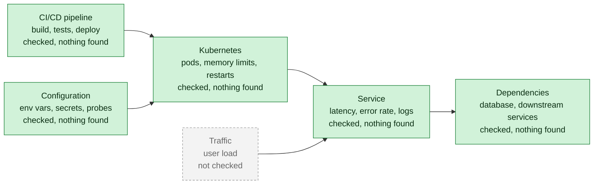
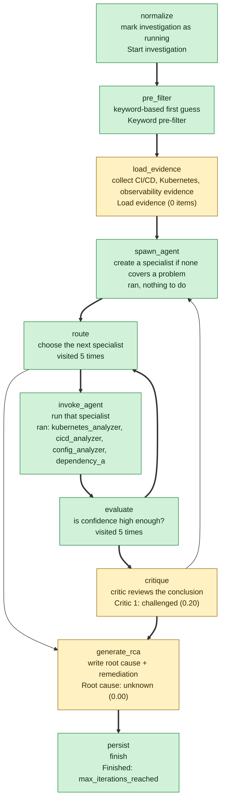

# Flow report: shoplite-S2

**ShopLite pods OOMKilled repeatedly — memory limit 128Mi exceeded**

- Result: Root cause: unknown (confidence 0.00, status max_iterations_reached).
- Decisions made by: `rules+fault:missing_evidence`
- Investigation id: `c5919c53-2389-4582-9d0a-1b2fb255a7f7`
- Injected fault (demo): `missing_evidence`

## Steps that need attention

- ⚠ **load_evidence** - Load evidence (0 items)
  - No evidence was found for this incident; every finding will be ungrounded.
- ⚠ **critique** - Critic #1: challenged (0.20)
  - No finding cites evidence that exists in this investigation.
  - Could not loop back (no rounds, iterations or unused agents left); the root cause is reported with this concern unresolved.
- ⚠ **generate_rca** - Root cause: unknown (0.00)
  - Agents used: kubernetes_analyzer -> cicd_analyzer -> config_analyzer -> dependency_analyzer -> observability_analyzer
  - The investigation ran out of iterations before reaching the confidence threshold.

## Where the fault is in the application

_green = fine · amber = worth a look · red = the fault · grey dashed = not visited_

## How the investigation ran

_Thick arrows are the path that was taken._

## Step by step

| # | | Node | What happened | Details |
|---|---|---|---|---|
| 1 | ✔ | `normalize` | Start investigation | Incident shoplite-S2: ShopLite pods OOMKilled repeatedly — memory limit 128Mi exceeded Decisions made by: rules+fault:missing_evidence Injected fault for this demo run: missing_evidence |
| 2 | ✔ | `pre_filter` | Keyword pre-filter | First guess: kubernetes_oom Wants to know about: deployment_details, pod_memory_status, pod_restart_pattern |
| 3 | ⚠ | `load_evidence` | Load evidence (0 items) | No evidence was found for this incident; every finding will be ungrounded. |
| 4 | ✔ | `route` | Route #1 -> kubernetes_analyzer | Hypothesis 'kubernetes_oom' maps to kubernetes_analyzer |
| 5 | ✔ | `invoke_agent` | kubernetes_analyzer: unknown (0.10) | No Kubernetes evidence found for this incident Evidence cited: 0, of which real: 0 |
| 6 | ✔ | `evaluate` | Confidence 0.00 / 0.75 (not enough yet) |  |
| 7 | ✔ | `route` | Route #2 -> cicd_analyzer | Evidence gap 'deployment_details' maps to cicd_analyzer |
| 8 | ✔ | `invoke_agent` | cicd_analyzer: unknown (0.10) | No CI/CD evidence found for this incident Evidence cited: 0, of which real: 0 |
| 9 | ✔ | `evaluate` | Confidence 0.00 / 0.75 (not enough yet) |  |
| 10 | ✔ | `route` | Route #3 -> config_analyzer | Default selection: config_analyzer |
| 11 | ✔ | `invoke_agent` | config_analyzer: unknown (0.00) | config_analyzer found nothing in the evidence that points to its kind of problem. Evidence cited: 0, of which real: 0 |
| 12 | ✔ | `evaluate` | Confidence 0.00 / 0.75 (not enough yet) |  |
| 13 | ✔ | `route` | Route #4 -> dependency_analyzer | Default selection: dependency_analyzer |
| 14 | ✔ | `invoke_agent` | dependency_analyzer: unknown (0.00) | dependency_analyzer found nothing in the evidence that points to its kind of problem. Evidence cited: 0, of which real: 0 |
| 15 | ✔ | `evaluate` | Confidence 0.00 / 0.75 (not enough yet) |  |
| 16 | ✔ | `route` | Route #5 -> observability_analyzer | Default selection: observability_analyzer |
| 17 | ✔ | `invoke_agent` | observability_analyzer: unknown (0.10) | No observability evidence found for this incident Evidence cited: 0, of which real: 0 |
| 18 | ✔ | `evaluate` | Confidence 0.00 / 0.75 (not enough yet) |  |
| 19 | ⚠ | `critique` | Critic #1: challenged (0.20) | No finding cites evidence that exists in this investigation. Could not loop back (no rounds, iterations or unused agents left); the root cause is reported with this concern unresolved. |
| 20 | ⚠ | `generate_rca` | Root cause: unknown (0.00) | Agents used: kubernetes_analyzer -> cicd_analyzer -> config_analyzer -> dependency_analyzer -> observability_analyzer The investigation ran out of iterations before reaching the confidence threshold. |
| 21 | ✔ | `persist` | Finished: max_iterations_reached |  |
