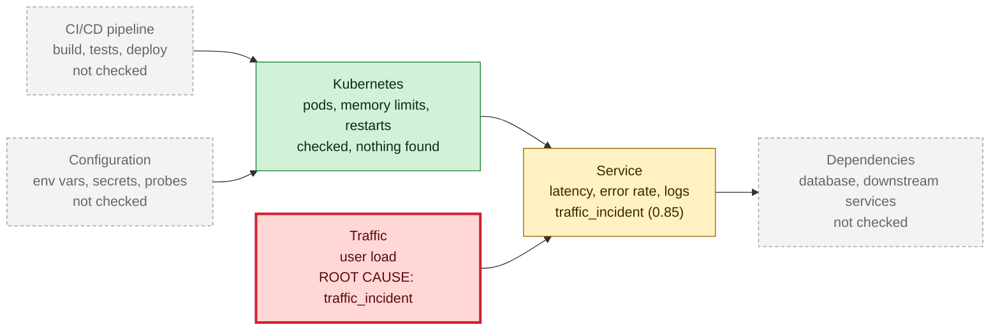
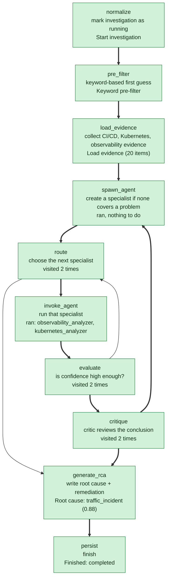

# Flow report: shoplite-S3

**ShopLite high latency and 5xx spike — P99 > 2950ms, error rate 41%**

- Result: Root cause: traffic_incident (confidence 0.88, status completed).
- Decisions made by: `rules`
- Investigation id: `e6b121ea-6184-4829-811e-a76ab8ab111f`

## Steps that need attention

None. Every step of the investigation ran cleanly.

## Where the fault is in the application

_green = fine · amber = worth a look · red = the fault · grey dashed = not visited_

## How the investigation ran

_Thick arrows are the path that was taken._

## Step by step

| # | | Node | What happened | Details |
|---|---|---|---|---|
| 1 | ✔ | `normalize` | Start investigation | Incident shoplite-S3: ShopLite high latency and 5xx spike — P99 > 2950ms, error rate 41% Decisions made by: rules |
| 2 | ✔ | `pre_filter` | Keyword pre-filter | First guess: traffic_incident Wants to know about: observability_metrics, traffic_pattern |
| 3 | ✔ | `load_evidence` | Load evidence (20 items) | Sources: cicd_fixture, kubernetes_fixture, observability_fixture |
| 4 | ✔ | `route` | Route #1 -> observability_analyzer | Hypothesis 'traffic_incident' maps to observability_analyzer |
| 5 | ✔ | `invoke_agent` | observability_analyzer: traffic_incident (0.85) | Requests are slow (p99 2950 ms) and 41.2% of them fail Evidence cited: 4, of which real: 4 |
| 6 | ✔ | `evaluate` | Confidence 0.88 / 0.75 (enough) | Per agent: observability_analyzer 0.88 |
| 7 | ✔ | `critique` | Critic #1: challenged (0.60) | The 'traffic_incident' conclusion rests on a single layer (observability_analyzer); nothing independent corroborates it. Sent back to the router; suggested agent: kubernetes_analyzer |
| 8 | ✔ | `route` | Route #2 -> kubernetes_analyzer | Critic challenged the conclusion and suggested kubernetes_analyzer |
| 9 | ✔ | `invoke_agent` | kubernetes_analyzer: unknown (0.30) | Pods look healthy: exit code 0, 0 restarts, memory at most 21% of the limit Evidence cited: 6, of which real: 6 |
| 10 | ✔ | `evaluate` | Confidence 0.88 / 0.75 (enough) | Per agent: observability_analyzer 0.88, kubernetes_analyzer 0.61 |
| 11 | ✔ | `critique` | Critic #2: confirmed (0.85) |  |
| 12 | ✔ | `generate_rca` | Root cause: traffic_incident (0.88) | Agents used: observability_analyzer -> kubernetes_analyzer |
| 13 | ✔ | `persist` | Finished: completed |  |
