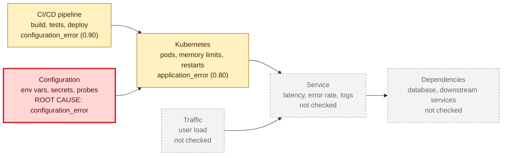
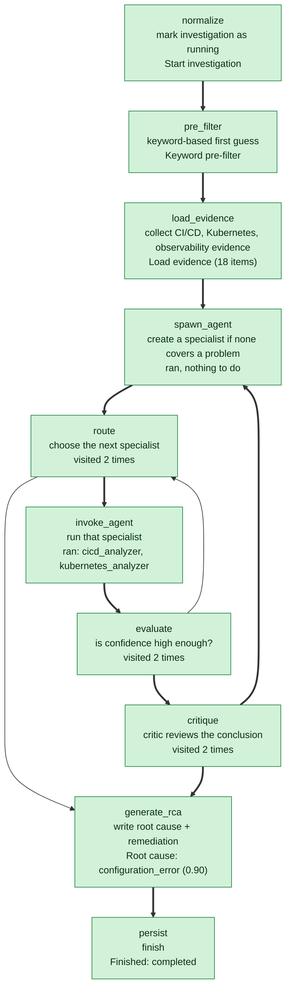

# Flow report: shoplite-S4

**ShopLite CrashLoopBackOff — startup failing due to missing env var**

- Result: Root cause: configuration_error (confidence 0.90, status completed).
- Decisions made by: `rules`
- Investigation id: `04b110dc-3e02-45f0-81b2-6b88b1cd7252`

## Steps that need attention

None. Every step of the investigation ran cleanly.

## Where the fault is in the application

_green = fine · amber = worth a look · red = the fault · grey dashed = not visited_

## How the investigation ran

_Thick arrows are the path that was taken._

## Step by step

| # | | Node | What happened | Details |
|---|---|---|---|---|
| 1 | ✔ | `normalize` | Start investigation | Incident shoplite-S4: ShopLite CrashLoopBackOff — startup failing due to missing env var Decisions made by: rules |
| 2 | ✔ | `pre_filter` | Keyword pre-filter | First guess: deployment_induced_failure Wants to know about: deployment_details, pod_restart_pattern, configuration_changes |
| 3 | ✔ | `load_evidence` | Load evidence (18 items) | Sources: cicd_fixture, kubernetes_fixture, observability_fixture |
| 4 | ✔ | `route` | Route #1 -> cicd_analyzer | Hypothesis 'deployment_induced_failure' maps to cicd_analyzer |
| 5 | ✔ | `invoke_agent` | cicd_analyzer: configuration_error (0.90) | A required setting was removed or broken by the release: Config change: FAULT = bad_config Evidence cited: 3, of which real: 3 |
| 6 | ✔ | `evaluate` | Confidence 0.85 / 0.75 (enough) | Per agent: cicd_analyzer 0.90 |
| 7 | ✔ | `critique` | Critic #1: challenged (0.60) | The 'configuration_error' conclusion rests on a single layer (cicd_analyzer); nothing independent corroborates it. The pre-filter flagged 'pod_restart_pattern' but kubernetes_analyzer has not looked at it yet. Sent back to the router; suggested agent: kubernetes_analyzer |
| 8 | ✔ | `route` | Route #2 -> kubernetes_analyzer | Critic challenged the conclusion and suggested kubernetes_analyzer |
| 9 | ✔ | `invoke_agent` | kubernetes_analyzer: application_error (0.80) | 2 pod(s) crash on startup with exit code 1; memory is only at 4% of the limit, so this is not a resource problem Evidence cited: 5, of which real: 5 |
| 10 | ✔ | `evaluate` | Confidence 0.90 / 0.75 (enough) | Per agent: cicd_analyzer 0.90, kubernetes_analyzer 0.85 |
| 11 | ✔ | `critique` | Critic #2: confirmed (0.90) |  |
| 12 | ✔ | `generate_rca` | Root cause: configuration_error (0.90) | Agents used: cicd_analyzer -> kubernetes_analyzer |
| 13 | ✔ | `persist` | Finished: completed |  |
