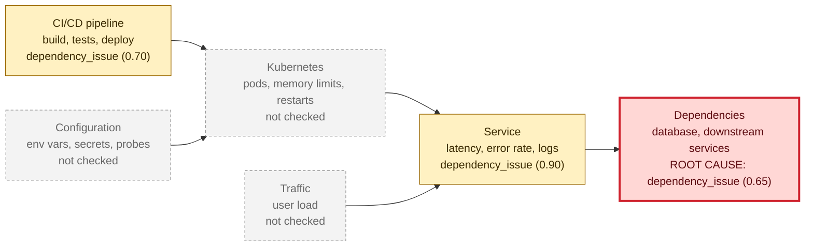
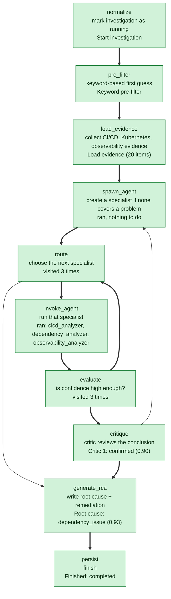

# Flow report: shoplite-S5

**ShopLite 100% error rate — database dependency unreachable**

- Result: Root cause: dependency_issue (confidence 0.93, status completed).
- Decisions made by: `rules`
- Investigation id: `c1bd6c64-7403-473a-b012-e4889f276bb0`

## Steps that need attention

None. Every step of the investigation ran cleanly.

## Where the fault is in the application

_green = fine · amber = worth a look · red = the fault · grey dashed = not visited_

## How the investigation ran

_Thick arrows are the path that was taken._

## Step by step

| # | | Node | What happened | Details |
|---|---|---|---|---|
| 1 | ✔ | `normalize` | Start investigation | Incident shoplite-S5: ShopLite 100% error rate — database dependency unreachable Decisions made by: rules |
| 2 | ✔ | `pre_filter` | Keyword pre-filter | First guess: deployment_induced_failure Wants to know about: deployment_details, observability_metrics, dependency_health |
| 3 | ✔ | `load_evidence` | Load evidence (20 items) | Sources: cicd_fixture, kubernetes_fixture, observability_fixture |
| 4 | ✔ | `route` | Route #1 -> cicd_analyzer | Hypothesis 'deployment_induced_failure' maps to cicd_analyzer |
| 5 | ✔ | `invoke_agent` | cicd_analyzer: dependency_issue (0.70) | The release touched a dependency: Config change: FAULT = db_down Evidence cited: 1, of which real: 1 |
| 6 | ✔ | `evaluate` | Confidence 0.52 / 0.75 (not enough yet) | Per agent: cicd_analyzer 0.67 |
| 7 | ✔ | `route` | Route #2 -> dependency_analyzer | Recent finding suggests dependency_issue; routing to dependency_analyzer |
| 8 | ✔ | `invoke_agent` | dependency_analyzer: dependency_issue (0.65) | Failing dependencies - databases, caches, downstream services, libraries: Log: Database unreachable — cannot load products; Log: Database unreachable — cannot persist order; Trace db-trace-001: 6ms Evidence cited: 3, of which real: 3 |
| 9 | ✔ | `evaluate` | Confidence 0.70 / 0.75 (not enough yet) | Per agent: cicd_analyzer 0.67, dependency_analyzer 0.75 |
| 10 | ✔ | `route` | Route #3 -> observability_analyzer | Evidence gap 'observability_metrics' maps to observability_analyzer |
| 11 | ✔ | `invoke_agent` | observability_analyzer: dependency_issue (0.90) | The service cannot reach something it depends on (Log: Database unreachable — cannot load products); error rate 100%, latency itself is 18 ms so the app is not overloaded Evidence cited: 3, of which real: 3 |
| 12 | ✔ | `evaluate` | Confidence 0.93 / 0.75 (enough) | Per agent: cicd_analyzer 0.67, dependency_analyzer 0.75, observability_analyzer 0.88 |
| 13 | ✔ | `critique` | Critic #1: confirmed (0.90) |  |
| 14 | ✔ | `generate_rca` | Root cause: dependency_issue (0.93) | Agents used: cicd_analyzer -> dependency_analyzer -> observability_analyzer |
| 15 | ✔ | `persist` | Finished: completed |  |
