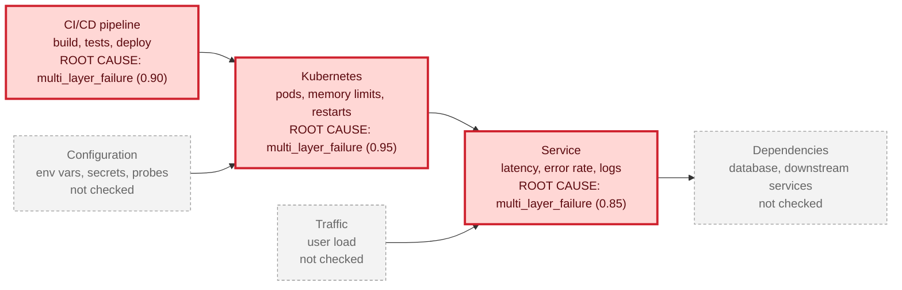
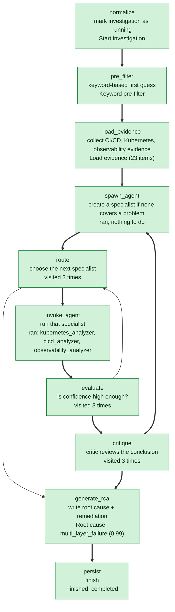

# Flow report: shoplite-S6

**ShopLite multi-layer failure — OOMKilled pods, high latency, high error rate**

- Result: Root cause: multi_layer_failure (confidence 0.99, status completed).
- Decisions made by: `rules`
- Investigation id: `7203050b-efa3-4d7b-beec-7601b9828dd6`

## Steps that need attention

None. Every step of the investigation ran cleanly.

## Where the fault is in the application

_green = fine · amber = worth a look · red = the fault · grey dashed = not visited_

## How the investigation ran

_Thick arrows are the path that was taken._

## Step by step

| # | | Node | What happened | Details |
|---|---|---|---|---|
| 1 | ✔ | `normalize` | Start investigation | Incident shoplite-S6: ShopLite multi-layer failure — OOMKilled pods, high latency, high error rate Decisions made by: rules |
| 2 | ✔ | `pre_filter` | Keyword pre-filter | First guess: kubernetes_oom Wants to know about: deployment_details, pod_memory_status, pod_restart_pattern, observability_metrics |
| 3 | ✔ | `load_evidence` | Load evidence (23 items) | Sources: cicd_fixture, kubernetes_fixture, observability_fixture |
| 4 | ✔ | `route` | Route #1 -> kubernetes_analyzer | Hypothesis 'kubernetes_oom' maps to kubernetes_analyzer |
| 5 | ✔ | `invoke_agent` | kubernetes_analyzer: kubernetes_oom (0.95) | 2 pod(s) were OOMKilled (exit code 137): they used more memory than their limit allows Evidence cited: 5, of which real: 5 |
| 6 | ✔ | `evaluate` | Confidence 0.83 / 0.75 (enough) | Per agent: kubernetes_analyzer 0.93 |
| 7 | ✔ | `critique` | Critic #1: challenged (0.60) | The 'kubernetes_oom' conclusion rests on a single layer (kubernetes_analyzer); nothing independent corroborates it. The pre-filter flagged 'deployment_details' but cicd_analyzer has not looked at it yet. Sent back to the router; suggested agent: cicd_analyzer |
| 8 | ✔ | `route` | Route #2 -> cicd_analyzer | Critic challenged the conclusion and suggested cicd_analyzer |
| 9 | ✔ | `invoke_agent` | cicd_analyzer: deployment_induced_failure (0.90) | A resource limit was changed in the release; the incident starts right after it: Config change: resources.limits.memory = 128Mi Evidence cited: 2, of which real: 2 |
| 10 | ✔ | `evaluate` | Confidence 0.88 / 0.75 (enough) | Per agent: kubernetes_analyzer 0.93, cicd_analyzer 0.83 |
| 11 | ✔ | `critique` | Critic #2: challenged (0.60) | The pre-filter flagged 'observability_metrics' but observability_analyzer has not looked at it yet. Sent back to the router; suggested agent: observability_analyzer |
| 12 | ✔ | `route` | Route #3 -> observability_analyzer | Critic challenged the conclusion and suggested observability_analyzer |
| 13 | ✔ | `invoke_agent` | observability_analyzer: traffic_incident (0.85) | Requests are slow (p99 3000 ms) and 78.3% of them fail Evidence cited: 3, of which real: 3 |
| 14 | ✔ | `evaluate` | Confidence 0.99 / 0.75 (enough) | Per agent: kubernetes_analyzer 0.93, cicd_analyzer 0.83, observability_analyzer 0.88 |
| 15 | ✔ | `critique` | Critic #3: confirmed (0.95) |  |
| 16 | ✔ | `generate_rca` | Root cause: multi_layer_failure (0.99) | Agents used: kubernetes_analyzer -> cicd_analyzer -> observability_analyzer |
| 17 | ✔ | `persist` | Finished: completed |  |
